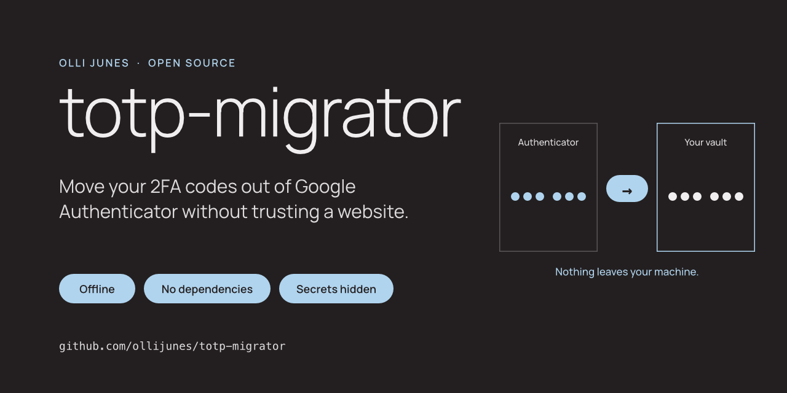
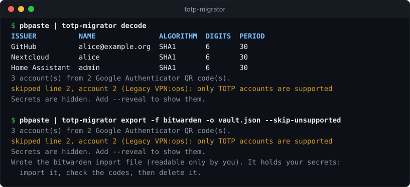
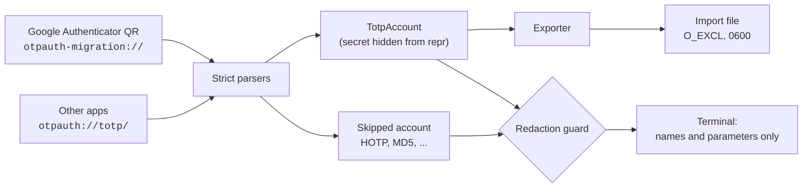

<div align="center">



[](https://github.com/ollijunes/totp-migrator/actions/workflows/ci.yml)
[](pyproject.toml)
[](pyproject.toml)
[](SECURITY.md)
[](LICENSE)

[Quick start](#quick-start) · [Export targets](#export-targets) · [How it works](#how-it-works) · [Privacy model](#privacy-model) · [FAQ](#faq) · [Security](SECURITY.md)



</div>

---

> My push to improve my own privacy made me question how much I could
> trust Google Authenticator with my 2FA secrets. So I built a tool to move
> them out.
>
> — Olli Junes

Google Authenticator exports your accounts as QR codes in its own format.
1Password, Bitwarden, Vaultwarden, Aegis, LastPass and Proton Pass can't read
them. Most converters are web pages, so you end up pasting every two-factor
secret you own into somebody else's JavaScript.

`totp-migrator` does the conversion on your machine. It reads Google
Authenticator export QR codes (`otpauth-migration://`) and standard
`otpauth://` URIs, and writes an import file for the app you're moving to.
It is one small Python package with no dependencies, so you can read all of
it before you trust it with your secrets.

| Reads | Writes |
|---|---|
| Google Authenticator exports, single or multi-QR | **1Password** item templates for `op item create` |
| `otpauth://totp/...` URIs from any authenticator | **Bitwarden / Vaultwarden** unencrypted JSON |
| | **Aegis** plain vault |
| | **LastPass** generic CSV |
| | **Proton Pass** generic CSV |
| | Plain `otpauth://` list, or structured JSON |

## Quick start

```sh
pipx install git+https://github.com/ollijunes/totp-migrator
```

Or run it from a clone, with nothing installed:

```sh
git clone https://github.com/ollijunes/totp-migrator && cd totp-migrator
python3 -m totp_migrator --help
```

**1. Get the URIs.** In Google Authenticator, open *Transfer accounts →
Export accounts* and pick the accounts. Decode the QR codes on your own
machine, for example with [zbar](https://github.com/mchehab/zbar):

```sh
umask 077   # files created from here on are readable only by you
zbarimg --raw -q qr-1.png qr-2.png > accounts.txt
```

URIs from other apps (`otpauth://totp/...`) can go in the same file, one
per line.

**2. Check what was read.** Nothing secret is printed:

```sh
totp-migrator decode accounts.txt
pbpaste | totp-migrator decode    # or straight from the clipboard
```

**3. Export, import, verify, delete.**

```sh
totp-migrator export -f bitwarden -o vault.json accounts.txt
```

Import the file, compare a few codes between the old and new app, delete
the file and the QR images, and only then remove the accounts from Google
Authenticator.

## Export targets

`export` writes a new file and never overwrites an existing one. On Linux
and macOS the file is readable only by you (mode `0600`). On Windows it
gets the permissions of its folder, so write it inside your user profile.
It refuses to print secrets to the terminal unless you add `--reveal`.

<details open>
<summary><b>Bitwarden and Vaultwarden</b></summary>

```sh
totp-migrator export -f bitwarden -o vault.json accounts.txt
```

In the web vault, open **Tools → Import data**, choose **Bitwarden (json)**
and select `vault.json`. A self-hosted Vaultwarden works the same way. With
the Bitwarden CLI: `bw import bitwardenjson vault.json`.

Each account becomes a Login item with the username and a full
`otpauth://` authenticator key, so non-default digits, periods and
algorithms survive.

</details>

<details>
<summary><b>1Password</b></summary>

```sh
totp-migrator export -f 1password -o items.jsonl accounts.txt

while IFS= read -r item; do
  printf '%s\n' "$item" | op item create --vault Private -
done < items.jsonl
```

Each line is a 1Password item template: a Login with a one-time password
field. The 1Password CLI reads it from stdin, so the secret never appears
in a process argument. `op item create --dry-run` previews an item without
creating it, but the preview prints every field, including the one-time
password URI.

</details>

<details>
<summary><b>Aegis</b></summary>

```sh
totp-migrator export -f aegis -o aegis.json accounts.txt
```

Copy the file to your phone, open Aegis's import screen (under
**Settings → Import & Export**), pick **Aegis** as the source app, and
select the file. It is an unencrypted Aegis vault in the format documented
in Aegis's `docs/vault.md`.

</details>

<details>
<summary><b>LastPass</b></summary>

```sh
totp-migrator export -f lastpass -o lastpass.csv accounts.txt
```

Import it as a *generic CSV file* from the LastPass vault's import page
(LastPass's [generic CSV help article](https://community.lastpass.com/kb/articles/56-import-data-into-lastpass-using-a-generic-csv-file%EF%BB%BF)
has the current menu path). Each account becomes a password item with the
TOTP secret key in its `totp` field.

LastPass stores only the bare secret key, so it always generates SHA1,
6-digit, 30-second codes. Accounts with other settings are listed as
unsupported; pass `--skip-unsupported` to export the rest. LastPass's help
pages describe TOTP in vault items as a feature some plans and admin
policies can turn off, so check that your account shows the codes.

Don't open the file in a spreadsheet app: it holds your secrets. Accounts
whose name starts with `=`, `+`, `-` or `@` are left out of this format and
listed, because spreadsheets treat such cells as formulas; add those by hand.

</details>

<details>
<summary><b>Proton Pass</b></summary>

```sh
totp-migrator export -f protonpass -o protonpass.csv accounts.txt
```

In the Proton Pass web app or browser extension, open **Settings → Import**,
choose **Generic CSV** and select the file. The columns follow Proton's own
[CSV template](https://pass.proton.me/assets/protonpass-import.csv). Each
account becomes a Login item with the account name as the username and a full
`otpauth://` URI in the `totp` column, so non-default digits, periods and
algorithms survive. Proton Pass asks which vault to put the items in
before it imports anything.

Proton Pass also imports Bitwarden JSON, so `-f bitwarden` works too.

Don't open the file in a spreadsheet app: it holds your secrets. Accounts
whose name starts with `=`, `+`, `-` or `@` are left out of this format and
listed, because spreadsheets treat such cells as formulas; add those by hand.

</details>

<details>
<summary><b>Plain URIs or JSON</b></summary>

```sh
totp-migrator export -f otpauth -o accounts.uris accounts.txt
totp-migrator export -f json -o accounts.json accounts.txt
```

`otpauth` writes one URI per line with every parameter spelled out.
`json` writes issuer, name, base32 secret, algorithm, digits, period and
URI for each account, for your own scripts.

</details>

**Tested with**

| Target | Status |
|---|---|
| 1Password | The predecessor of this tool moved the author's own Google Authenticator accounts into 1Password with `op` 2.39, using the same item template (Login with an OTP field, created over stdin). Every code matched. |
| Bitwarden / Vaultwarden | Imported on every CI run into Vaultwarden 1.37.4 with the official Bitwarden CLI 2026.9.1. Every code is checked against this tool's own TOTP, including SHA256 / 8-digit / 60-second and SHA512 accounts. |
| LastPass | On every CI run, the CSV is read by the Bitwarden CLI's LastPass importer and every code is checked. Not yet imported into LastPass itself. |
| Aegis | Matches Aegis's documented plain vault format (`docs/vault.md`, db version 3). Not yet imported. |
| Proton Pass | Imported into the Proton Pass web app (1.42.0, October 2026) as Generic CSV; both synthetic accounts, including a SHA256 / 8-digit / 60-second one, showed the same codes as this tool. On every CI run, the CSV also goes through Proton Pass's own import path, replayed with the same `papaparse` and `otpauth` packages Proton Pass uses, and every code and parameter is checked. |

Whichever app you use, compare a few codes after importing, and please
[open an issue](https://github.com/ollijunes/totp-migrator/issues/new/choose)
if an app rejects a file. Reports of a successful import, with the app
version, are welcome too.

## How it works



- **Parsers.** The Google payload is protobuf, decoded by a small
  hand-written reader. There is no official schema; the field numbers
  match two independent reverse-engineered descriptions (Aegis's
  `google_auth.proto` and qistoph's `OtpMigration.proto`). Anything the
  parser doesn't recognise stops the run instead of being guessed at.
- **One model.** Every account becomes a `TotpAccount`. Accounts the tool
  won't migrate become a `SkippedAccount` with a reason, so you know
  exactly what to move by hand.
- **Exporters** are plain functions from accounts to file contents.
- **Redaction guard.** Every line that mentions an account is checked
  against every secret in the input before it's printed.

**Supported input**

| Input | Notes |
|---|---|
| `otpauth-migration://offline?data=...` | Google Authenticator export, versions 1 and 2, single or multi-QR. All QR codes of a multi-QR export must be present. |
| `otpauth://totp/...` | [Key Uri Format](https://github.com/google/google-authenticator/wiki/Key-Uri-Format): SHA1/SHA256/SHA512, 6-8 digits, any period up to an hour. |

HOTP (counter-based) accounts, MD5, missing names and other unusual values
are reported as unsupported, with the account's position and name. `export`
stops when it finds one; pass `--skip-unsupported` to export the rest.
Secrets shorter than 8 bytes (64 bits) or longer than 256 are rejected as
malformed. Google's export carries no period, so those accounts get the
30 seconds the app itself uses.

## Privacy model

[SECURITY.md](SECURITY.md) has the full list of guarantees and limits. In
short:

- **No network.** A test fails if any module imports a networking library,
  and the CLI tests run with sockets disabled.
- **Nothing secret on screen by default.** Without `--reveal`, every line
  that mentions an account must pass a guard that refuses any secret in
  base32, hex, base64 or raw form, matched exactly, with separators
  removed, and reduced to letters and digits. A bug that pulled a secret
  into a message fails instead of printing it.
- **No secrets in shell history.** URIs are read from a file or a pipe.
  Arguments that look like URIs are refused, and so is reading from an
  interactive terminal, where pasted URIs would echo. Usage errors don't
  repeat what you typed, and the output path isn't printed back.
- **No spoofed names.** Account names with control, bidi-override or
  zero-width characters are rejected, so a crafted QR code can't disguise
  one account as another.
- **Careful files.** `O_EXCL`, mode `0600` on Linux and macOS, every
  message checked before the file exists, and a failed write removes the
  file.

What it can't protect: the export file once written, the QR images, your
terminal after `--reveal`, and the apps you import into.

## FAQ

<details>
<summary><b>Why not use one of the web-based converters?</b></summary>

Because the input is every 2FA secret you have. Even a page that claims to
run locally in the browser can change what it ships tomorrow. This tool
has no network code at all, and it is small enough to read first.

</details>

<details>
<summary><b>Can I check the codes before I delete anything?</b></summary>

Yes. `decode --reveal` prints the current code for each account next to
its secret, after a warning. Compare them with the old and the new app.

</details>

<details>
<summary><b>An account was skipped. What now?</b></summary>

The message says which line and account, and why. HOTP and MD5 accounts
are rare; set them up again in the new app from the service's 2FA settings,
or copy them by hand from the old app.

</details>

<details>
<summary><b>The tool says an export is incomplete.</b></summary>

Google Authenticator splits large exports into several QR codes. All of
them must be in the input, or accounts would silently go missing. Scan the
remaining codes and add them to the same file.

</details>

<details>
<summary><b>Does it work on Windows?</b></summary>

Yes, CI runs on Windows, macOS and Linux with Python 3.10 to 3.14. On
Windows the export file inherits its folder's permissions instead of
getting mode `0600`.

</details>

<details>
<summary><b>Can it import straight into my vault?</b></summary>

No, on purpose. Talking to a vault means network access and credentials.
The tool writes a file; your vault's own importer reads it.

</details>

## Development

```sh
python3 -m unittest            # standard library only
python3 docs/render_demo.py    # regenerate docs/demo.svg from a real run
```

The Proton Pass test needs Node and npm; CI runs it on every push. Locally:

```sh
python3 integration/protonpass_import.py
```

The Vaultwarden import test needs Docker, Node and the `cryptography`
package; CI runs it on every push. Locally:

```sh
integration/start_vaultwarden.sh /tmp/vw 8443
NODE_EXTRA_CA_CERTS=/tmp/vw/ssl/cert.pem python3 integration/vaultwarden_import.py \
  --server https://127.0.0.1:8443 --bw "npx -y @bitwarden/cli@2026.9.1"
docker stop totp-migrator-vaultwarden
```

Tests use only synthetic secrets and the published RFC 4226 and RFC 6238
test vectors. See [CONTRIBUTING.md](CONTRIBUTING.md). Never commit or paste
a real QR code, URI or export file, not even in an issue.

## License

[MIT](LICENSE)
